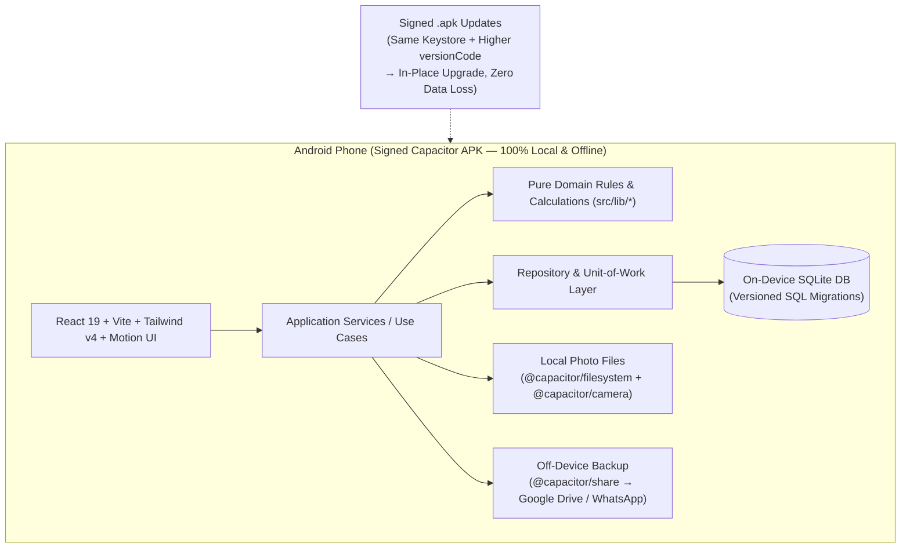

# Udeni's Specials — Architecture & Requirements Design

**Document version:** 2.0  
**Status:** Part 1 Web/PWA UI Complete (`feature/remaining-workflows`); Local-First Capacitor Android `.apk` + On-Device SQLite Architecture Approved (Phase 12)  
**Platform:** Mobile-first React 19 + Vite 8 Web/PWA packaged as an offline-first Android `.apk` (Capacitor)  
**Business:** Udeni's Specials — Home Kitchen & Bakery  
**Currency:** Sri Lankan Rupee (LKR)  
**Measurement system:** Metric  
**Deployment model:** 100% local-first, single-device Android `.apk` with on-device SQLite and user-controlled off-device backups

---

## 1. Project Overview

### 1.1 Purpose

Udeni's Specials is a mobile application designed to digitize the everyday operations of a small home bakery.

The application replaces handwritten order records, manually calculated ingredient requirements, shopping lists, inventory notes, and scattered financial records with one integrated system.

The application must reflect the actual workflow of a home bakery rather than impose the processes of a commercial warehouse, manufacturing plant, or enterprise accounting system.

### 1.2 Primary objectives

The application should enable Udeni to:

1. Record and manage customer orders.
2. Maintain reusable recipes for bakery products and their variants.
3. Create new recipes while entering customer orders.
4. Calculate ingredient and packaging requirements.
5. Combine multiple recipes into one consolidated shopping list.
6. Record planned and unexpected purchases.
7. Track ingredient, packaging, and finished-product inventory.
8. Prepare products and record actual ingredient usage after baking.
9. Manage extra products prepared for future sales.
10. Record collections, sales, payments, refunds, and customer balances.
11. Calculate estimated and actual costs, suggested prices, and profitability.
12. Manage direct and shared business expenses.
13. Review upcoming work and potential scheduling conflicts.
14. Preserve business data through manual backups and validated restoration.

### 1.3 Guiding principles

- Keep everyday interactions simple.
- Do not require phone interaction while Udeni is actively baking.
- Do not prevent order confirmation merely because inventory is insufficient.
- Avoid duplicate data entry where information can be calculated safely.
- Preserve historical order, cost, payment, and inventory records.
- Require explicit confirmation for consequential changes.
- Keep calculations deterministic and testable.
- Prefer straightforward workflows over unnecessary architectural complexity.
- Make the initial release useful without internet connectivity or a backend.

---

## 2. Scope

### 2.1 Included in the initial release

- Dashboard and workload overview.
- Customer management and order history.
- Draft, confirmed, in-progress, completed, and cancelled orders.
- Product catalogue and product variants.
- Recipe Library and recipe history.
- Recipe yield and quantity scaling.
- Recipe-based shopping cart.
- Consolidated and editable shopping lists.
- Purchase recording and purchase corrections.
- Ingredient and packaging inventory.
- Finished-product inventory for extra-stock batches.
- Inventory reservations and actual consumption.
- Stock adjustments, waste, damage, and returns.
- Cost estimation and pricing calculations.
- Labour estimates and actual labour costing.
- Direct and shared expenses.
- Partial payments, outstanding balances, refunds, and cancellation settlements.
- Quick sales and customer-linked sales.
- Basic business reports.
- JSON backup and restore.
- Weekly backup reminders with dismiss and snooze controls.
- Local database persistence and versioned migrations.

### 2.2 Excluded from the initial release

- Backend server and cloud database.
- Multi-user collaboration and synchronization.
- Customer-facing online ordering.
- Supplier-management accounts and supplier-credit workflows.
- Barcode scanning.
- Automated purchase ordering.
- Advanced warehouse and batch-management functionality.
- Automatic cloud backups.
- Recurring-expense automation.
- Complex manufacturing scheduling.
- Automatic recipe changes based on actual usage.
- Enterprise accounting and tax-management features.

Future additions must be evaluated against actual bakery needs before being introduced.

---

## 3. Technology Stack

| Area | Technology |
|---|---|
| UI & Application Framework | React 19 + Vite 8 + TypeScript 5.7 |
| Styling & Design Tokens | Tailwind CSS v4 (`oklch(...)` perceptual color tokens) |
| Motion & Physics | `motion/react` (mass-scaled critically damped & elastic springs) |
| Icons | `lucide-react` + custom SVG illustrations (`Illustration.tsx`) |
| Android APK Packaging | **Capacitor (`@capacitor/android`)** |
| Local Database | **On-Device SQLite** (`@capacitor-community/sqlite` on Android; browser dev adapter for Chrome testing) |
| Native Device Plugins | `@capacitor/camera`, `@capacitor/filesystem`, `@capacitor/share`, `@capacitor/app`, `@capacitor/status-bar`, `@capacitor/keyboard`, `@capacitor/haptics` |
| State & Domain Logic | React reducer (`AppState.tsx`) + pure TypeScript domain modules (`src/lib/*`) + Repository/Unit-of-Work layer |
| Unit & Integration Testing | Vitest (`pnpm test`) |
| Android Testing & Build | Android Studio Emulator + Gradle signed `.apk` (no physical phone required until final QA) |
| Version Control & CI | Git, GitHub, and GitHub Actions |
| Currency & Units | Whole LKR (`INTEGER`) + Metric (`g`/`kg`, `ml`/`L`, `unit`) |

The application runs **100% locally on an Android device** with zero cloud server dependency, zero hosting cost, and full airplane-mode usability.

---

## 4. Architecture

### 4.1 Architectural style

Use a layered architecture with explicit separation of responsibilities.

The application should be organized into the following layers:

1. Presentation layer.
2. Application and use-case layer.
3. Domain and calculation layer.
4. Repository interfaces.
5. SQLite repository implementations.
6. Local persistence layer.

### 4.2 Logical architecture



### 4.3 Presentation layer

Responsibilities:

- Render screens and reusable UI components.
- Collect and validate user input.
- Display application state.
- Show confirmation dialogs, errors, warnings, and success feedback.
- Invoke application use cases.

The presentation layer must not contain SQL statements or independently implement financial calculations.

### 4.4 Application layer

The application layer coordinates workflows such as:

- Creating and confirming orders.
- Creating and updating recipes.
- Generating shopping lists.
- Recording purchases.
- Reserving and releasing inventory.
- Completing product preparation.
- Recording sales and payments.
- Processing cancellations and refunds.
- Allocating shared expenses.
- Creating and restoring backups.

Use cases should enforce business rules and coordinate transactions across related records.

### 4.5 Domain layer

The domain layer contains independently testable rules for:

- Recipe scaling.
- Unit conversion.
- Ingredient and packaging costing.
- Weighted-average inventory valuation.
- Inventory reservations.
- Order state transitions.
- Pricing calculations.
- Payment balances and refunds.
- Shared-expense allocation.
- Actual consumption.
- Waste and stock corrections.
- Finished-product stock.
- Profit calculations.

Pure calculations should not depend on React Native components or SQLite.

### 4.6 Persistence layer

SQLite is the authoritative local source of business data.

Repository implementations provide typed access to database records. Database transactions must protect operations that update multiple related records.

Use versioned SQL migrations to evolve the database schema safely.

Do not maintain a second competing global copy of all business data in application state.

### 4.7 Transactional integrity

The following operations require transactional handling:

- Confirming an order and creating its reservations.
- Approving an order recost or material change.
- Recording a purchase and updating stock valuation.
- Completing preparation and deducting actual consumption.
- Recording a sale and reducing finished-product stock.
- Recording a refund and updating financial balances.
- Applying a stock correction.
- Applying a shared-expense allocation version.
- Restoring a backup.

A failed transaction must not leave partially updated records.

Operations that may be submitted repeatedly must be idempotent where appropriate. For example, repeating a preparation-completion action must not deduct ingredients twice.

---

## 5. Core Navigation and Screens

The primary navigation should remain appropriate for a phone.

### 5.1 Main sections

The implemented mobile shell uses a 4-tab bottom navigation bar so every daily workflow is reachable in one tap without crowding narrow screens:

1. **Home** (`today`) — `Up next` priority card, `New order`, contextual **Payments due** alert, 2×2 snapshot (`Due today`, `Ready`, `To buy`, `This month`), `Upcoming pickups`, Notifications bell, and `Settings`.
2. **Orders** (`orders`) — `Active`, `Ready`, `Due`, `Done`, and `All` filters, search, `CreateOrderFlow`, `OrderDetailScreen`, `PreparationProductScreen`, and `CustomersScreen`.
3. **Kitchen** (`kitchen`) — Consolidated **Shopping** (`To buy`) list and **Recipes & Products** catalogue (`RecipesScreen`).
4. **Money** (`money`) — Minimalistic **Overview** (with tappable unpaid/part-paid breakdown & CSV exports), **Expenses**, and **Budget**.

Customers, settings, backup/restore, and extra-stock workflows remain accessible from `Home` and `Orders` without overcrowding primary navigation.

### 5.2 Dashboard

The dashboard should display:

- Orders due soon.
- Products requiring preparation.
- Products currently being prepared.
- Products ready for collection.
- Ingredient and packaging shortages.
- Shopping requirements.
- Finished products remaining in stock.
- Outstanding customer balances.
- Estimated workload and scheduling warnings.
- Relevant best-before dates.
- Backup status and access to backup settings.

The dashboard must prioritize actionable information rather than display excessive statistics.

### 5.3 Order history

Users must be able to search and filter orders by:

- Customer name or phone number.
- Product or variant.
- Order date.
- Required completion or collection date.
- Order status.

Historical orders must preserve their recorded prices, recipe snapshots, cost snapshots, payments, and change history.

A repeat-order action should copy relevant customer and product details into a new draft without copying the previous order's payment transactions or completion status.

---

## 6. Product Catalogue and Variants

Products represent the types of food and baked items Udeni sells or prepares.

Examples include:

- Cakes (chocolate celebration cake, butter cake, sponge cakes).
- Pastries & sweets (cupcakes, brownies, cookies, short-eats).
- Pizzas & savories (pizzas, rolls, cutlets).
- Condiments & bottled specials (chili paste, chutneys, spice mixes).

Products, recipes, ingredients, and packaging support visual thumbnails from the built-in multi-category SVG food library (`preset:*`) or compressed local photos captured/picked from the device gallery.

A product can have multiple variants.

Examples:

- Chocolate cake — 500 g.
- Chocolate cake — 1 kg.
- Cupcakes — individual.
- Cupcakes — box of 6.
- Cupcakes — box of 12.

Each variant may define:

- Display name.
- Product or variant unit.
- Standard quantity or finished weight.
- Associated recipe.
- Packaging requirements.
- Default preparation-time estimate.
- Default pricing inputs.
- Availability or archive status.

Variants may share a recipe where appropriate, but variants requiring different ingredient proportions should have distinct recipe definitions or explicit variant-specific quantities.

All product weights use metric units.

---

## 7. Recipe Library

### 7.1 Purpose

The Recipe Library is the central collection of reusable product recipes.

Recipes define how products are made. They are separate from customer orders and individual preparation batches.

### 7.2 Recipe capabilities

Udeni must be able to:

- Create a recipe.
- View a recipe.
- Edit a recipe.
- Save a recipe for reuse.
- Select a saved recipe while creating an order.
- Create a recipe directly during order entry.
- Explicitly save that new recipe to the Recipe Library.
- Associate recipes with product variants.
- Specify recipe yield and unit type.
- Enter ingredient quantities and units.
- Record preparation instructions.
- Review historical recipe versions where needed.
- Archive recipes that should no longer be used for new work.

### 7.3 Recipe yield

Every recipe must define its expected yield.

Examples:

- One cake.
- Twelve cupcakes.
- Twenty-four cookies.

Where useful, the recipe may also specify the expected finished weight.

Recipe scaling must be based on the relationship between requested output and recipe yield.

For example, if a recipe yields 12 cupcakes and Udeni needs 24, the ingredient requirements are multiplied by two.

### 7.4 Recipe selection during order creation

When creating an order, Udeni should be able to:

1. Select a product.
2. Select a product variant.
3. Select an existing recipe or create a new recipe.
4. Enter the requested quantity.
5. Review the calculated ingredient and packaging requirements.
6. Review estimated costs and selling price.
7. Save a newly created recipe to the Recipe Library if desired.
8. Save or confirm the order.

Saving a recipe to the library must be an explicit action. A one-off adjustment must not accidentally become the default recipe for future customers.

### 7.5 Recipe changes

Editing a reusable recipe must not silently modify:

- Existing confirmed orders.
- Existing confirmed cost snapshots.
- Existing inventory reservations.
- Existing planned preparation batches.

A new recipe version may be used for future orders and future preparation plans.

If an existing order must use a revised recipe, Udeni must explicitly approve the proposed change and review its effects.

### 7.6 Actual usage

Adjusting actual quantities during preparation changes the usage recorded for that preparation. It must not automatically rewrite the reusable recipe.

---

## 8. Order Management

### 8.1 Order lifecycle

The standard lifecycle is:

```text
Draft
  |
  v
Confirmed
  |
  v
In Progress
  |
  v
Completed
```

Cancelled is a separate terminal business status.

Completion means the ordered products have been handed over to the customer. Payment settlement is tracked independently.

### 8.2 Draft orders

Draft orders may be edited freely within validation rules.

Editable fields include:

- Customer.
- Products and variants.
- Quantities.
- Selected recipes.
- Collection date and time.
- Special instructions.
- Estimated costs.
- Proposed selling price.
- Labour estimates.

Draft orders do not reserve inventory.

### 8.3 Confirming an order

On confirmation, the application must:

1. Validate required order details.
2. Preserve the agreed selling price.
3. Create an immutable initial confirmed cost snapshot.
4. Record the recipe and ingredient quantities used for the snapshot.
5. Calculate ingredient and packaging requirements.
6. Attempt to reserve available inventory.
7. Record any shortages.
8. Update shopping requirements.
9. Display the confirmed order and its preparation status.

Insufficient stock must never automatically prevent order confirmation.

### 8.4 Confirmed-order changes

Changes to an existing confirmed order must be explicit.

Examples include:

- Changing a cake from 500 g to 1 kg.
- Changing the product quantity.
- Changing the selected recipe.
- Changing the collection time.

Cost-affecting changes must show the proposed effects on:

- Ingredient requirements.
- Packaging requirements.
- Stock reservations.
- Shopping requirements.
- Estimated costs.
- Suggested or agreed selling price, where applicable.

Udeni must review and approve consequential changes before they are committed.

The original order details and change history must remain available.

### 8.5 Order cancellation

Cancellation requires a reason.

The application must preserve:

- Original order details.
- Payments.
- Refunds.
- Purchase records.
- Confirmed cost snapshots.
- Actual consumption.
- Preparation history.
- Cancellation settlement.

Cancellation must release unconsumed reservations but must not reverse consumption already recorded.

Reusable purchased ingredients remain inventory assets where appropriate. They must not automatically be treated as losses.

### 8.6 Completed orders

Completed orders must not ordinarily be reopened for production changes.

They may receive:

- Additional payments.
- Eligible refunds.
- Explicit financial corrections.
- Relevant settlement adjustments.

Completed orders retain their historical production and financial records.

---

## 9. Inventory Model

### 9.1 Inventory categories

The application tracks:

1. Ingredients.
2. Packaging materials.
3. Finished products prepared for future sale.

Ingredients and packaging use a common inventory framework with resource-specific units and validation.

Finished products use batch-based stock records so the application can track remaining quantities and optional best-before dates.

### 9.2 Inventory quantities

For ingredients and packaging, distinguish:

- Physical stock.
- Reserved quantity.
- Available quantity.
- Quantity needed by upcoming work.
- Quantity purchased.
- Usable quantity received.

Available quantity is calculated as:

```text
Available Stock = Physical Stock - Active Reservations
```

The application must not treat reserved stock as available for another confirmed order.

### 9.3 Reservations

Draft orders do not reserve inventory.

Confirmed orders reserve available quantities according to their approved confirmed-order requirements.

If stock is insufficient, the application reserves only the available amount according to a consistent allocation rule and records the remaining shortage.

The same physical quantity must never be allocated to multiple orders.

Reservation calculations must use the quantities associated with the approved order snapshot, not silently recalculate historical requirements from a mutable recipe.

If a confirmed order is explicitly recosted or changed, the application must show and confirm any reservation changes.

### 9.4 Stock movements

Inventory changes must be recorded as explicit movements.

Examples include:

- Purchase received.
- Preparation consumption.
- Return to stock.
- Spoilage.
- Damage.
- Stock correction.
- Purchase correction.
- Other justified adjustment.

Each movement should record the affected item, quantity, date, reason or movement type, and related business record where applicable.

Stock balances must be updated transactionally with their corresponding movement records.

### 9.5 Stock discrepancies

The application must not silently create negative inventory.

When recorded usage exceeds available stock, it should explain the discrepancy and let Udeni correct the record, purchase additional material, or reconcile the physical balance.

Any correction must be explicit and traceable.

---

## 10. Recipe Shopping Cart and Shopping Lists

### 10.1 Purpose

The Recipe Shopping Cart allows Udeni to combine ingredient requirements for:

- Confirmed customer orders.
- Extra products planned for future sales.

The cart is a planning tool. Adding a recipe does not create a customer order, reserve stock, purchase ingredients, or deduct inventory.

### 10.2 Shopping cart workflow

1. Select a product and variant.
2. Select its recipe.
3. Enter the requested preparation quantity.
4. Repeat for other products.
5. Review the combined ingredient requirements.
6. Compare requirements with available stock.
7. Generate the consolidated shopping list.
8. Edit quantities to suit practical package sizes.
9. Record purchases while shopping.
10. Review remaining requirements.

### 10.3 Requirement calculation

For each recipe ingredient:

```text
Scaled Requirement =
Recipe Ingredient Quantity
× Requested Output Quantity
÷ Recipe Yield
```

The result must be converted to a compatible canonical unit before combining it with other requirements.

For each inventory item:

```text
Net Shopping Requirement =
Maximum(0, Total Planned Requirement - Available Stock)
```

This calculation must account for existing reservations and other relevant committed requirements.

Customer-order requirements and extra-stock requirements should remain distinguishable even when their ingredient quantities are combined.

### 10.4 Example

Suppose Udeni plans:

- Five chocolate cakes.
- Twenty-four cupcakes.

The application scales each recipe and combines duplicate ingredients.

If the combined flour requirement is 1,970 g and available stock after reservations is 500 g:

```text
Flour to Purchase = 1,970 g - 500 g
                  = 1,470 g
```

Udeni can adjust the practical purchase quantity to 2 kg.

### 10.5 Editing shopping lists

Udeni must be able to:

- Edit quantities.
- Remove unnecessary items.
- Add unexpected items.
- Mark items as purchased.
- Record actual quantities and prices.
- Revisit a shopping session.
- Review outstanding requirements.

Changing a recipe or shopping plan must not silently erase actual purchases or their history.

### 10.6 Shopping sessions

A shopping session records the shopping plan and its purchase progress.

Purchases may originate from a shopping list or be recorded independently.

Reopening a session must not record a purchase twice.

Actual purchase quantities and prices are separate from planned quantities and estimated costs.

---

## 11. Purchase Recording and Inventory Valuation

### 11.1 Purchase records

A purchase may contain multiple items.

Each purchase item should record:

- Inventory item.
- Purchased quantity.
- Total purchase cost.
- Usable quantity.
- Applicable unit.
- Purchase date.
- Optional notes.
- Relevant shopping session, if any.

Purchases may be recorded even when they were not on a shopping list.

For example, Udeni can buy extra chocolate while shopping for butter.

### 11.2 Purchased and usable quantities

Purchased quantity and usable quantity must be separate.

Example:

- Purchased flour: 1,000 g.
- Total cost: Rs. 320.
- Unusable quantity: 50 g.
- Usable quantity received: 950 g.

The usable unit cost is:

```text
Rs. 320 / 950 g
= Rs. 0.336842... per g
```

The application must not count unusable material as available stock.

If material becomes unusable later, record a separate loss movement while preserving the original purchase.

### 11.3 Weighted-average costing

Use moving weighted-average costing for ingredients and packaging.

```text
New Average Unit Cost =
(Existing Stock Value + New Usable Purchase Cost)
/
(Existing Stock Quantity + New Usable Quantity)
```

Actual consumption and inventory losses are valued using the applicable weighted-average unit cost.

When stock reaches zero, both its quantity and stock value become zero. A subsequent purchase establishes the new average from the newly received stock.

### 11.4 Purchase corrections and refunds

Purchase corrections must preserve the original record and create an explicit adjustment.

If a purchase price or quantity was recorded incorrectly, the application must reconcile its effects on remaining stock and historical costs without silently rewriting completed order snapshots.

Any actual shop refund or purchase correction must be recorded separately and linked to the original purchase where applicable.

Do not introduce a supplier-management or supplier-credit subsystem.

---

## 12. Product Preparation

### 12.1 Preparation workflow

Each product within a multi-product order has its own preparation progress.

The preparation workflow is:

1. Open the confirmed order.
2. Select a product that requires preparation.
3. Start preparation.
4. Display the applicable recipe and instructions.
5. Allow Udeni to bake without requiring ongoing phone interaction.
6. After baking, display estimated recipe quantities for review.
7. Allow adjustment to actual ingredient and packaging usage.
8. Confirm Complete Preparation.
9. Deduct actual quantities, release unused reservations, and update actual ingredient costs transactionally.

### 12.2 No premature deduction

Starting preparation does not physically deduct inventory.

The application must preserve the order and preparation state if Udeni closes the app during preparation.

### 12.3 Actual consumption

Actual quantities must reflect what was used, not automatically what the recipe estimated.

If Udeni uses 550 g of chocolate instead of the estimated 500 g, the recorded consumption is 550 g.

If she uses less, the unused reserved quantity is released and remains available.

The reusable recipe is not automatically changed.

### 12.4 Completion integrity

Completing preparation must be idempotent.

Repeating the same completion action must not deduct ingredients or packaging twice.

If a stock discrepancy exists, the application must request an explicit resolution rather than silently producing negative inventory.

### 12.5 Multiple-product orders

For an order containing a cake and cupcakes, Udeni can prepare each product separately.

The overall order remains in progress until all required products are prepared.

The order becomes ready for collection when all required preparation is complete.

---

## 13. Extra-Stock Preparation and Finished Products

### 13.1 Purpose

Extra-stock preparation supports products made for future sales without attaching them to a specific customer order.

Examples include:

- Twelve cupcakes prepared for weekend sales.
- Cookies prepared in advance.
- Cakes prepared for general sale.

### 13.2 Batch lifecycle

```text
Planned
  |
  v
Prepared
  |
  v
Available for Sale
  |
  +----> Sold
  |
  +----> Written Off / Discarded
```

The exact status model may be simplified during implementation, provided it preserves the necessary records.

### 13.3 Batch records

A preparation batch should record:

- Product and variant.
- Planned quantity.
- Actual prepared quantity.
- Recipe version used.
- Actual ingredient and packaging consumption.
- Actual cost.
- Preparation date.
- Remaining quantity.
- Optional best-before date.
- Sales and waste movements.

### 13.4 Finished-product stock

Finished products are tracked separately from raw ingredients.

If Udeni prepares 12 cupcakes, sells 8, and discards 4:

- Prepared quantity: 12.
- Sold quantity: 8.
- Discarded quantity: 4.
- Remaining quantity: 0.

Sales reduce finished-product stock. Waste reduces finished-product stock and records the loss.

Ingredients already consumed during preparation must not be deducted a second time.

Best-before dates are optional reminders, not automatic proof that a product must be discarded.

---

## 14. Sales and Customer Management

### 14.1 Customer records

Customer records may include:

- Name.
- Phone number.
- Relevant notes.
- Order history.

Customer details are not mandatory for every sale.

### 14.2 Quick sales

Udeni must be able to record a walk-in sale without creating a customer profile.

A quick sale records:

- Products sold.
- Quantities.
- Selling prices.
- Discounts, if supported.
- Payment information.
- Sale date.
- Relevant finished-stock batch movements.

The sale must reduce finished-product inventory and update sales reports.

### 14.3 Customer-linked sales

A sale may be linked to an existing customer or a newly created customer record.

Customer-linked sales allow future lookup and repeat-customer history.

### 14.4 Repeat orders

A repeat-order action creates a new draft from an existing order.

Copy:

- Customer details.
- Products and variants.
- Quantities.
- Relevant special instructions.

Do not copy:

- Payment transactions.
- Refund transactions.
- Completion status.
- Actual consumption.
- Previous stock movements.

The new order must use the current applicable recipe and costing inputs unless Udeni explicitly selects another permitted option.

---

## 15. Costing and Pricing

### 15.1 Cost categories

The application distinguishes:

- Ingredient costs.
- Packaging costs.
- Other direct costs.
- Labour costs.
- Allocated shared expenses.

Product-level direct costs and order-level costs must be clearly distinguished to avoid double-counting.

### 15.2 Estimated cost

Estimated product cost is based on the applicable recipe quantities, ingredient costs, packaging, and other direct costs.

Order-level estimated cost may include:

- Product line costs.
- Order-level labour.
- Applicable shared-expense allocations.

### 15.3 Actual cost

Actual order cost uses recorded actual consumption, actual attributable costs, actual labour, and the applicable approved expense allocations.

Estimated and actual values must remain distinct.

### 15.4 Pricing calculations

Margin-based pricing:

```text
Suggested Price = Cost / (1 - Target Margin)
```

Markup-based pricing:

```text
Suggested Price = Cost * (1 + Markup Rate)
```

Margin must be less than 100%.

Example:

- Cost: Rs. 1,000.
- Target margin: 30%.
- Calculated price: Rs. 1,428.57 before defined rounding.
- Suggested price may be rounded to the nearest Rs. 10.

A 30% markup on the same cost produces Rs. 1,300.

The interface must distinguish calculated price, rounded suggested price, and agreed selling price.

### 15.5 Historical prices and costs

Changing ingredient prices or reusable recipes must not silently change confirmed order snapshots.

A confirmed order preserves its original agreed selling price and confirmed cost snapshot unless an explicit change or recost is approved.

Selling-price changes and cost recosting are separate actions.

### 15.6 Money precision

Represent authoritative monetary values (order `agreedPrice`, `costSnapshot` totals, `payments`, `refunds`, `expenses`, `purchases.totalPrice`, `BudgetPlan` targets/limits, and rounded `suggestedPrice`) as **whole LKR `INTEGER`** values (`Number.isSafeInteger`).

Where intermediate unit costs require sub-rupee precision (such as per-gram or per-ml `average_unit_cost` in moving weighted-average inventory valuation), retain decimal precision (`REAL` / `NUMERIC` in SQLite) during calculation, and apply explicit half-away-from-zero rounding at stored line/total boundaries.

Cost lines must follow the approved line-level rounding rules before totals are summed.

---

## 16. Labour Costing

### 16.1 Defaults and overrides

Maintain a global default hourly labour rate.

Allow an optional per-order override.

Changes to the global default affect future estimates only. Confirmed orders retain their original labour inputs.

### 16.2 Estimated labour

Estimated labour time is entered in quarter-hour increments.

Estimated labour cost:

```text
Estimated Labour Cost =
Estimated Hours * Applicable Hourly Rate
```

The application must distinguish an unset estimate from an explicitly entered zero.

### 16.3 Actual labour

Actual labour time is recorded separately from estimated labour.

Actual time may be entered in whole minutes.

```text
Actual Labour Cost =
Actual Minutes / 60 * Applicable Hourly Rate
```

The application preserves actual time, the applicable rate, and the original estimate.

Any correction to actual labour must be explicit and traceable.

---

## 17. Shared Expenses

### 17.1 Expense categories

Direct expenses may be associated with a specific product or order.

Shared expenses are recorded once and manually allocated across selected eligible orders.

Examples include relevant shared utility or operating expenses.

### 17.2 Manual expense recording

Udeni records an expense when she actually pays it.

The application does not automatically create recurring expense transactions.

### 17.3 Allocations

Each allocation must record:

- Expense.
- Selected orders.
- Allocated amounts.
- Allocation version.
- Timestamp.
- Optional reason.

The total allocation must not exceed the applicable allocatable balance.

Any unallocated amount remains visible.

### 17.4 Allocation history

Changing an allocation creates a new version instead of overwriting the original history.

Changes that affect confirmed cost snapshots must be identified and require explicit approval before recosting.

### 17.5 Reporting

Reports must distinguish historical recorded or approved costs from the latest approved view.

An expense must not be counted both as a direct cost and again as an allocated shared expense.

### 17.6 Persistence defaults

Built-in expense categories are `Utilities` and `Other`, identified by stable IDs; custom categories use their own stable IDs. Phase 11 separated runtime defaults (`src/data/defaults.ts`) and the minimal 1-item UI verification starter slice (`src/data/starterData.ts`) from test fixtures (`src/test/demoFixture.ts`), ensuring empty or restored workspaces never receive injected mock inventory. Schema v7 local data and v2 backup files migrate forward cleanly into on-device SQLite (Phase 13).

---

## 18. Payments, Refunds, and Cancellation Settlements

### 18.1 Payments

Support multiple payments per order.

Each payment records:

- Amount.
- Date.
- Payment method.
- Optional notes or reference.
- Related order.

Deposits and instalments are supported.

### 18.2 Refunds

Refunds are separate transactions linked to the original payment and relevant order.

The original payment must never be overwritten.

Cumulative refunds must not exceed the eligible amount received for that payment.

Refunds require explicit review and confirmation.

### 18.3 Outstanding balances

For an ordinary order:

```text
Net Payments = Successful Payments - Refunds
```

```text
Outstanding Balance =
Maximum(0, Agreed Selling Price - Net Payments)
```

```text
Customer Credit =
Maximum(0, Net Payments - Agreed Selling Price)
```

Outstanding balances and customer credit must be displayed separately.

### 18.4 Order completion

An order becomes Completed when the customer collects the products, even if payment remains outstanding.

Later payments can be recorded against the completed order.

The dashboard must continue to display unpaid balances independently of production status.

### 18.5 Cancellation settlement

On cancellation, Udeni explicitly enters the applicable cancellation charge or retained amount.

The application calculates a suggested refund from recorded payments and the cancellation settlement amount.

Example:

- Payments received: Rs. 3,000.
- Approved cancellation charge: Rs. 800.
- Suggested refund: Rs. 2,200.

Udeni must review and confirm the suggested refund.

The application must not issue or record a refund automatically without her confirmation.

Cancellation settlement, retained deposits, actual production costs, and reusable inventory must remain distinguishable.

---

## 19. Workload and Scheduling

### 19.1 Preparation-time defaults

Each product variant has a default preparation-time estimate.

Udeni may override that estimate for a specific order.

### 19.2 Workload calculation

The dashboard estimates upcoming preparation workload using the applicable estimates and quantities.

It should highlight potential conflicts when the estimated workload exceeds the available time.

The estimate must be clearly identified as approximate.

### 19.3 Scheduling limitations

The initial release does not require automatic production scheduling or complex task optimization.

The application should not assume all preparation work must occur sequentially. Baking and other tasks may overlap.

Udeni retains control over priorities and scheduling decisions.

### 19.4 Collection changes

Udeni may change an order's collection date and time without cancelling and recreating it.

The application preserves the original arrangement in history and uses the revised time in the dashboard.

---

## 20. Metric Units and Quantity Validation

### 20.1 Supported units

Mass:

- g
- kg

Volume:

- ml
- litres

Count:

- pieces or product-specific count units.

### 20.2 Compatible conversions

```text
1 kg = 1,000 g
1 litre = 1,000 ml
```

Automatic conversion is allowed only between compatible units.

The application must never assume that 1 g equals 1 ml.

Mass-to-volume conversions require an explicit ingredient-specific conversion factor.

### 20.3 Quantity validation

- Negative recipe quantities are invalid.
- Included recipe ingredients must have positive quantities.
- Fractional mass and volume quantities may be supported to the agreed precision.
- Pieces are whole numbers by default, unless the item is explicitly divisible.
- Invalid or missing conversion factors must be rejected.
- Missing or invalid cost inputs must not be treated as zero.
- User-entered values must not be silently rounded merely to satisfy validation.

---

## 21. Data Integrity and Corrections

### 21.1 Traceable history

Financial and inventory records must preserve their history.

Corrections should create explicit adjustments or correction records rather than silently overwrite consequential history.

### 21.2 Deletion rules

Unused drafts and records with no protected dependencies may be deleted where appropriate.

Referenced records should generally be archived rather than permanently deleted.

Payments, refunds, purchase records, stock movements, confirmed cost snapshots, and completed order history must not be silently erased.

### 21.3 Confirmed snapshots

Confirmed cost snapshots must preserve the information needed to reconstruct the approved historical estimate, including:

- Product and variant.
- Recipe version.
- Ingredient quantities and conversions.
- Ingredient cost inputs.
- Packaging and direct costs.
- Labour inputs.
- Applicable shared-expense allocation.
- Calculation and rounding rules.
- Total estimated cost.
- Pricing inputs.
- Agreed selling price.

Snapshots must not depend on mutable records to reconstruct their original values.

### 21.4 Order state restrictions

Drafts may be edited freely within validation rules.

Confirmed orders require explicit approval for cost-affecting changes.

In-progress orders retain their original confirmed snapshot while recording actual preparation and cost information.

Completed orders do not ordinarily reopen for production edits.

Cancelled orders retain their historical records and may receive eligible settlement actions.

---

## 22. Backup and Restore

### 22.1 Backup format

The application supports versioned JSON backup files.

A backup should contain all required business records, relationships, identifiers, settings, and format metadata.

Recommended metadata includes:

- Backup format version.
- Creation timestamp.
- Application version.

### 22.2 Manual & off-device backup

Udeni can create a backup manually at any time. In the Android `.apk` (Phase 14+), **1-tap backup export** uses `@capacitor/filesystem` + `@capacitor/share` so she can save the `.json` (or password-encrypted) backup directly to her free **Google Drive**, WhatsApp, or device Downloads folder with zero cloud server required.

The application must show the last successful backup date.

### 22.3 Backup reminders

The application displays a weekly backup reminder.

The reminder may be dismissed or snoozed.

It must not interrupt active preparation or prevent ordinary work.

### 22.4 Optional encryption

Password-protected encrypted backups are supported.

Use a vetted cryptographic library, authenticated encryption, and a suitable password-based key derivation function.

Do not implement custom cryptography.

The password must not be stored in application settings or inside the backup.

The interface must explain that losing the password may make the backup unrecoverable.

### 22.5 Restore validation

Before replacing local data, the application must validate:

- File structure.
- Format version.
- Required records.
- Relationships and identifiers.
- Data integrity.
- Cryptographic authentication, if encrypted.

Unsupported newer formats and corrupted backups must be rejected safely.

### 22.6 Safe restoration

Restoration replaces local business data only after explicit confirmation.

The existing database must remain intact if validation or restoration fails.

Use a transaction or staged restoration strategy, followed by integrity verification.

---

## 23. Reporting

The first release should provide practical business summaries rather than complex accounting reports.

Reports should cover:

- Sales over a selected period.
- Recorded expenses.
- Estimated and actual order costs.
- Estimated and actual profit.
- Outstanding customer balances.
- Payments and refunds.
- Inventory quantities and valuation.
- Extra-stock sales and waste.
- Unallocated shared expenses.

Reports must distinguish cash movement, sales revenue, inventory purchases, ingredient consumption, and profit.

Purchasing ingredients for future use must not automatically be treated as equivalent to consuming those ingredients.

---

## 24. Testing Strategy

### 24.1 Domain unit tests

Test independently:

- Recipe scaling.
- Unit conversions.
- Ingredient costing.
- Weighted-average valuation.
- Price calculations.
- Rounding.
- Inventory reservations.
- Actual consumption.
- Stock adjustments.
- Payment balances.
- Refund eligibility.
- Cancellation settlement calculations.
- Shared-expense allocation.
- Workload estimation.

### 24.2 Repository and database tests

Test:

- Database migrations.
- Repository operations.
- Transactions.
- Referential integrity.
- Purchase recording.
- Inventory movement consistency.
- Snapshot preservation.
- Backup export and restore.
- Failed restoration behavior.

### 24.3 Workflow tests

Verify end-to-end scenarios:

1. Create and confirm an order with insufficient inventory.
2. Create a recipe during order entry and save it to the library.
3. Combine multiple recipes into one shopping list.
4. Record purchases from and outside a shopping list.
5. Prepare a multi-product order and record actual consumption.
6. Prevent duplicate consumption on repeated completion.
7. Prepare and sell extra-stock products.
8. Record waste without deducting ingredients twice.
9. Complete an order with an outstanding balance.
10. Change or cancel a confirmed order.
11. Process a refund with explicit confirmation.
12. Correct an inventory or financial record.
13. Restore a valid backup and safely reject an invalid backup.

### 24.4 UI tests

Use component and integration tests for:

- Form validation.
- Navigation.
- Empty states.
- Error and warning messages.
- Confirmation dialogs.
- Preparation progress.
- Shopping-list editing.
- Inventory shortage handling.
- Payment entry.
- Backup and restore interactions.

### 24.5 Acceptance testing

The app must support the complete practical workflow from receiving a customer order through shopping, preparation, handover, and payment tracking without requiring internet connectivity.

---

## 25. Implementation Roadmap

The authoritative phase-by-phase implementation plan (Part 1: Completed Web/PWA UI Phases 0–11; Part 2: Local-First SQLite, Native Plugins & Signed Android `.apk` Phases 12–17) is maintained in [`docs/IMPLEMENTATION_ROADMAP.md`](IMPLEMENTATION_ROADMAP.md).

---

## 26. Definition of Done

The initial release is ready when:

1. Udeni can create and manage customer orders.
2. Udeni can save, select, and reuse recipes.
3. Udeni can create and save a new recipe directly from an order.
4. Product variants scale ingredient requirements correctly.
5. Confirmed orders can exist despite stock shortages.
6. Inventory reservations prevent double allocation.
7. Shopping lists combine recipe requirements and remain editable.
8. Purchases update inventory and valuation correctly.
9. Preparation completion records actual usage without double deduction.
10. Extra-stock batches can be prepared, sold, and written off.
11. Order handover and payment settlement remain independent.
12. Financial and inventory history remains traceable.
13. Cost calculations and rounding follow defined rules.
14. Backup and restore preserve data integrity.
15. The primary workflow works offline on Android.
16. Automated tests cover critical calculations and transactional workflows.
17. The approved Figma design and implemented screens remain consistent.

---

## 27. Requirements Still Requiring Detailed Specification

The overall product scope and primary workflow have been established. The following details must be finalized during detailed design and implementation planning:

- Exact product and recipe data relationships.
- Recipe versioning and archival rules.
- Exact order state-transition matrix.
- Reservation allocation and reallocation edge cases.
- Exact handling of partial preparation and preparation cancellation.
- Final cancellation settlement and retained-deposit reporting rules.
- Treatment of refunds after stock or financial corrections.
- Shared-expense allocation versioning and report presentation.
- Exact historical versus latest-approved profit reporting behavior.
- Backup encryption parameters and compatibility policy.
- Exact database schema, indexes, and migration strategy.
- Exact Figma screen layouts, component states, and navigation.
- Exact package versions and Expo compatibility.

These details must be resolved without contradicting the agreed business rules.

---

## 28. Final Architecture Principle

Udeni's Specials should be a practical, reliable digital assistant for a small home bakery.

Its core concepts must remain distinct:

- **Recipes** define how products are made.
- **Orders** represent customer commitments.
- **Shopping plans** calculate what may need to be purchased.
- **Purchases** record what was actually bought.
- **Inventory** records available physical stock and reservations.
- **Preparation records** capture what was actually made and consumed.
- **Sales and handovers** record what was sold or delivered.
- **Financial records** capture payments, refunds, expenses, and profitability.

These concepts work together through explicit, testable rules. They must not be collapsed into a single record or updated implicitly in ways that destroy historical information.

The first release should prioritize correctness, simplicity, traceability, offline reliability, and a natural baking workflow over feature count or architectural sophistication.

---

## 29. Architecture Decision Records (v2.0 — Phase 12 Gate)

### ADR-001: Package as a Local-First Android `.apk` via Capacitor
- **Context:** The original spec envisioned an Expo React Native port, while Phases 0–11 delivered a polished React 19 + Vite 8 + Tailwind v4 + Motion UI with 270 passing tests.
- **Decision:** Package `dist/` directly into an Android `.apk` using **Capacitor (`@capacitor/android`)** instead of rewriting the UI in React Native.
- **Consequences:** 100% UI, animation, and domain test reuse; zero rewrite risk; full access to native Android SQLite, Camera, Filesystem, Share Sheet, and Hardware Back button.

### ADR-002: 100% Local-First Operation (No Cloud Backend Server)
- **Context:** Udeni's Specials is a personal single-owner app. Free cloud databases sleep or expire (e.g., 7-day/30-day limits), require login/network, and add sync-conflict complexity.
- **Decision:** Run the entire application **100% locally on Udeni's Android phone** with no cloud backend server, no user login wall, and \$0/month hosting cost.
- **Consequences:** Instant airplane-mode operation, complete privacy, and single-database simplicity. Multi-device live sync is deferred unless a future business need justifies it.

### ADR-003: On-Device SQLite with Versioned Migrations
- **Context:** `localStorage` has ~5 MB limits and is vulnerable to browser cache clears.
- **Decision:** Replace `localStorage` with on-device **SQLite** (`@capacitor-community/sqlite` on Android, with a browser storage adapter for fast Chrome development) accessed through a transactional Repository / Unit-of-Work layer and versioned SQL migrations.
- **Consequences:** ACID multi-table transactions, unlimited practical storage for years of orders, and safe automatic schema upgrades across `.apk` updates.

### ADR-004: Expanded Multi-Category Food Domain & Local Filesystem Media
- **Context:** The business prepares cakes, pastries, pizzas, savories, chili pastes, and custom foods. Base64 photos bloat JSON backups.
- **Decision:** Maintain the multi-category SVG food preset library (`src/lib/imageLibrary.ts`) and store captured/uploaded photos (including future customer order reference photos) as compressed files via `@capacitor/filesystem` + `@capacitor/camera`.
- **Consequences:** Fast DB queries, compact JSON backups, and rich visual identification across orders, recipes, preparation, and stock.

### ADR-005: Off-Device Backups via Android Share Sheet & Validated v2 JSON Restore
- **Context:** With no cloud DB, phone loss/damage must be mitigated without friction.
- **Decision:** Keep the weekly backup reminder and v2 JSON (plus optional password-encrypted) backup format, enhanced with 1-tap Android Share Sheet export (`@capacitor/share`) straight to Udeni's free **Google Drive** or WhatsApp.
- **Consequences:** Zero-cost cloud backup safety controlled directly by Udeni, with strict pre-restore validation.

### ADR-006: Monetary Precision Reconciliation
- **Context:** Original §15.6 specified minor units (`× 100`), whereas the implemented domain and all 270 tests operate in whole LKR integers (`Number.isSafeInteger`).
- **Decision:** Store authoritative monetary amounts (`agreedPrice`, `payments`, `refunds`, `expenses`, `purchases.totalPrice`, `BudgetPlan`) as **whole LKR `INTEGER`**, while keeping decimal precision (`REAL`) for per-gram/ml `average_unit_cost`.
- **Consequences:** Eliminates mismatch between spec, UI, and tests while keeping weighted-average costing accurate.

### ADR-007: Post-Release Updates via Consistently Signed `.apk` In-Place Upgrades
- **Context:** Bug fixes and new features must reach Udeni's phone without wiping her existing bakery records.
- **Decision:** Sign every release `.apk` with the **same release keystore (`.jks`, stored safely outside Git)** and increment Android `versionCode` on each release, paired with an optional lightweight in-app update check reading a static `version.json` on GitHub Releases when online.
- **Consequences:** Tapping "Update" on a newly sent `.apk` upgrades the app in place, preserves all SQLite data and photos, and runs any new SQLite migrations automatically.

---

## 30. Implemented UI & Navigation Specification (Reference)

Architecture and UX decisions finalized in the implemented React 19 + Vite 8 + TypeScript 5.7 + Tailwind CSS v4 application (`src/`):

- **4-Tab Information Architecture:**
  - **`Home` (`today`):** Greeting, `Up next` priority card, `New order` CTA, contextual **Payments due** warning banner (shown whenever non-draft, non-cancelled orders have `outstandingOrderBalance > 0`), 2×2 snapshot (`Due today`, `Ready`, `To buy`, `This month`), `Upcoming pickups`, Notifications bell (`selectAttentionItems`, swipe-to-clear with Undo), and `Settings`.
  - **`Orders` (`orders`):** `Active`, `Ready`, `Due (N)`, `Done`, and `All` filter pills; `OrderCard` with live `dd:hh:mm:ss` pickup countdowns (`CountdownBadge`), `Due Rs. X` balance cues, and contextual quick actions (`Confirm`, `To buy`, `Bake`, `Collected`, `Add payment`). Confirming `Collected` with a remaining balance automatically opens the **Record payment** dialog pre-filled with the balance due. Payment methods use a structured dropdown (`Cash`, `Online transaction`, `Other` with optional custom label) shared across order deposits and step-by-step payments.
  - **`Kitchen` (`kitchen`):**
    - **Shopping (`To buy`):** Driven by manual pantry checklist toggles (`Have` / `Buy`) on order items (`SET_PANTRY_CHECKLIST_ITEM`). Consolidates minimal total quantities across orders, displays calculated per-item and total estimated `Rs.` values from inventory unit prices (`Rs./kg | L | unit`), and records actual purchases via `ShoppingTripSheet`.
    - **Recipes & Products:** Products define customer-facing items and size/pack variants, with an optional **"Copy recipe from existing"** selector when creating a new product (`ProductEditorSheet`). Recipes hold ingredients, packaging, inline `Rs./kg | L | unit` unit prices, batch scaling (`0.5×`–`10×`), `PricingCalculatorSheet`, preparation steps, and version history.
    - **Direct Order-Linked Preparation (`PreparationProductScreen`):** Tapping `Start bake` dispatches `START_PREPARATION` (`startedAt` timestamp) and switches to a minimalistic **Baking State** view showing scaled recipe quantities, numbered preparation steps, `Cook mode`, and a live `dd:hh:mm:ss` recipe timer (`startedAt + preparationMinutes`). `Mark ready` is gated until all steps are checked and redirects directly back to the order's `Ready for pickup` page.
  - **`Money` (`money`):** Minimalistic **Overview** (`Sales earned`, `Cash received`, `Money spent`, `Monthly goal`, tappable `Unpaid customer orders` row opening the **Unpaid & part-paid orders** sheet, and collapsible `Breakdown & exports` with CSV exports), **Expenses**, and **Budget**.
- **Monthly Budgeting (`BudgetPlan`):** Supports both revenue/profit targets and per-category / ingredient spending limits evaluated against the `Asia/Colombo` calendar month, with 80% warning and 100% over-limit alerts surfaced on `Home` and `Money`.
- **Motion, Accessibility & Error Resilience:** Top-level `ErrorBoundary`, physics-based spring tokens (`src/lib/motion.ts`), OKLCH color continuity, `TouchRipple` feedback, and clipped zero-pop `PushView` transitions.

