# Udeni's Specials — On-Device SQLite Database Schema

**Schema Version:** `1` (`0001_initial_schema`)  
**Target Engines:** On-device SQLite 3 via `@capacitor-community/sqlite` (Android `.apk`) and `node:sqlite` (Vitest verification suite), with an `IndexedDB` key-value fallback adapter (`IndexedDbAppRepository`) for browser development.  
**Related ADRs:** `docs/ARCHITECTURE_DECISIONS.md` (ADR-002, ADR-003, ADR-006, ADR-007)

---

## 1. Design Principles & Invariants

- **Foreign Keys & WAL:** Every SQLite connection executes `PRAGMA foreign_keys = ON;`. File-backed Android connections use `PRAGMA journal_mode = WAL;` for crash safety during kitchen and market use.
- **Monetary Precision (ADR-006):** Authoritative financial figures (`orders.agreed_price`, `payments.amount`, `refunds.amount`, `expenses.amount`, `purchases.total_price`, `budget_plans` targets/limits, `shopping_trips.total_spent`) are stored as whole LKR `INTEGER` values. Weighted-average unit costs (`inventory_items.average_unit_cost`) use `REAL` for sub-rupee per-gram / per-ml accuracy.
- **Append-Only Ledgers:** Historical financial and stock events (`inventory_movements`, `payments`, `refunds`, `finished_stock_transactions`, `expense_allocation_versions`) are preserved as immutable records rather than overwritten.
- **Immutable Order & Recipe Snapshots:** `orders` and `order_lines` store JSON snapshots (`cost_snapshot_json`, `reservations_json`, `shortages_json`, `recipe_snapshot_json`) so editing reusable recipes or ingredient prices never alters confirmed order history.
- **Idempotency Protection:** `idempotency_keys` guards double-tap actions (such as completing preparation or recording purchases) against duplicate deductions.
- **In-Place `.apk` Upgrade Safety:** Forward-only numbered migrations tracked in `schema_migrations` execute atomically inside transactions on app startup when an updated `.apk` increments the schema version.

---

## 2. Entity-Relationship Diagram

```mermaid
erDiagram
  customers ||--o{ orders : places
  products ||--|{ product_variants : defines
  orders ||--|{ order_lines : contains
  orders ||--o{ payments : receives
  orders ||--o{ refunds : settles
  payments ||--o{ refunds : refunds
  orders ||--o{ preparation_records : tracks
  finished_stock_batches ||--o{ finished_stock_transactions : records
  expense_categories ||--o{ expenses : classifies
  expenses ||--o{ expense_allocation_versions : versions
  expense_allocation_versions ||--|{ expense_allocations : splits

  app_settings {
    int id PK "Always 1"
    text business_name
    text owner_name
    int default_labour_rate_per_hour
    text default_pricing_mode
    real default_margin_percent
    real default_markup_percent
    int price_rounding_step
  }

  budget_plans {
    int id PK "Always 1"
    int monthly_sales_target
    int monthly_profit_target
    int ingredient_spend_limit
    text category_limits_json
    text updated_at
  }

  notification_preferences {
    int id PK "Always 1"
    text read_ids_json
    text dismissed_ids_json
    text updated_at
  }

  customers {
    text id PK
    text name
    text phone
  }

  products {
    text id PK
    text name
    text image
    int archived
  }

  product_variants {
    text id PK
    text product_id FK
    text name
    text unit_label
    text finished_inventory_id
    int archived
  }

  recipes {
    text id PK
    text name
    text product_id
    text variant_id
    int version
    real yield
    int preparation_minutes
    real estimated_cost
  }

  inventory_items {
    text inventory_id PK
    text name
    real physical
    text unit
    text category
    real average_unit_cost
    int archived
  }

  inventory_movements {
    text id PK
    text inventory_id
    text type
    real quantity_delta
    text unit
    real balance_after
    text date
    text reason
  }

  purchases {
    text id PK
    text inventory_id
    real purchased_quantity
    real usable_base_quantity
    int total_price
    text date
  }

  orders {
    text id PK
    text reference UK
    text customer_id FK
    text status
    text preparation_status
    text payment_status
    text collection_date
    int agreed_price
  }

  order_lines {
    text id PK
    text order_id FK
    text product_id
    text variant_id
    real quantity
    text recipe_id
  }

  payments {
    text id PK
    text order_id FK
    text date
    int amount
    text method
  }

  refunds {
    text id PK
    text order_id FK
    text payment_id FK
    text date
    int amount
    text reason
  }

  preparation_records {
    text id PK
    text order_id FK
    text order_line_id
    text status
    real planned_quantity
    int actual_cost
  }

  extra_stock_plans {
    text id PK
    text product_id
    text variant_id
    text recipe_id
    real quantity
    text best_before
  }

  extra_stock_preparations {
    text id PK
    text plan_id
    text finished_inventory_id
    real planned_batches
    text status
  }

  finished_stock_batches {
    text id PK
    text source
    text inventory_id
    real remaining_quantity
  }

  finished_stock_transactions {
    text id PK
    text type
    text batch_id FK
    text inventory_id
    real quantity
    text occurred_at
  }

  expense_categories {
    text id PK
    text name
    text source
  }

  expenses {
    text id PK
    int amount
    text paid_date
    text category_id FK
    text attribution_type
  }

  expense_allocation_versions {
    text id PK
    text expense_id FK
    int version
    text created_at
  }

  expense_allocations {
    text id PK
    text version_id FK
    text order_id
    int amount
  }

  shopping_selections {
    text inventory_id PK
    real quantity
  }

  shopping_trips {
    text id PK
    text reference UK
    text date
    int total_spent
  }

  idempotency_keys {
    text key PK
    text operation
    text created_at
  }
```

---

## 3. Table Specifications & Constraints

### 3.1 Configuration & Preferences
| Table | Primary Key | Key Constraints & Notes |
|---|---|---|
| `app_settings` | `id` (`CHECK (id = 1)`) | Singleton row storing business profile, pricing defaults (`default_pricing_mode IN ('margin', 'markup')`, `price_rounding_step IN (1, 50, 100)`), labour rate, and backup reminder dates. |
| `budget_plans` | `id` (`CHECK (id = 1)`) | Singleton row storing optional monthly targets/limits (`>= 0`) and `category_limits_json`. |
| `notification_preferences` | `id` (`CHECK (id = 1)`) | Singleton row storing `read_ids_json`, `dismissed_ids_json`, and `updated_at`. |
| `schema_migrations` | `version` | Tracks applied migration version, name, and ISO timestamp. |
| `idempotency_keys` | `key` | Deduplicates retried mutating workflows (`operation`, `created_at`). |

### 3.2 Catalogue, Recipes & Inventory
| Table | Primary Key | Foreign Keys & Constraints |
|---|---|---|
| `customers` | `id` | `CHECK (length(trim(name)) > 0)` |
| `products` | `id` | `CHECK (length(trim(name)) > 0)`, `archived IN (0, 1)` |
| `product_variants` | `id` | `product_id -> products(id) ON DELETE CASCADE`, `archived IN (0, 1)` |
| `recipes` | `id` | `version >= 1`, `yield > 0`, `preparation_minutes >= 0`, `estimated_cost >= 0`, JSON columns for `ingredients`, `packaging`, `instructions`, optional `expected_output` & `history` |
| `inventory_items` | `inventory_id` | `physical >= 0`, `unit IN ('g', 'ml', 'unit')`, `category IN ('ingredient', 'packaging', 'finished')`, nullable `unbatched_legacy_quantity`, `low_stock_threshold`, `average_unit_cost` all `>= 0` |
| `purchases` | `id` | `purchased_quantity > 0`, `usable_quantity > 0`, `usable_base_quantity > 0`, `total_price >= 0`, valid unit enums |
| `inventory_movements` | `id` | `type` enum check, `unit IN ('g', 'ml', 'unit')`, `balance_after >= 0` |
| `shopping_selections` | `inventory_id` | `quantity >= 0` |
| `shopping_trips` | `id` | `reference UNIQUE`, `total_spent IS NULL OR total_spent >= 0`, `items_json` |

### 3.3 Orders, Production & Finished Stock
| Table | Primary Key | Foreign Keys & Constraints |
|---|---|---|
| `orders` | `id` | `reference UNIQUE`, `customer_id -> customers(id) ON DELETE SET NULL`, `status`, `preparation_status`, `payment_status` enums, `agreed_price >= 0`, immutable JSON snapshots |
| `order_lines` | `id` | `order_id -> orders(id) ON DELETE CASCADE`, `quantity > 0`, `recipe_snapshot_json` |
| `preparation_records` | `id` | `order_id -> orders(id) ON DELETE CASCADE`, `UNIQUE (order_id, order_line_id)`, `planned_quantity > 0`, `status IN ('Awaiting preparation', 'In progress', 'Ready', 'Cancelled')` |
| `extra_stock_plans` | `id` | `quantity > 0`, `recipe_snapshot_json` |
| `extra_stock_preparations` | `id` | `planned_batches > 0`, `status` enum check, `actual_usage_json`, `completed_steps_json` |
| `finished_stock_batches` | `id` | `source IN ('production', 'legacy-opening')`, `remaining_quantity >= 0`, `payload_json` |
| `finished_stock_transactions` | `id` | `type IN ('sale', 'write-off')`, `batch_id -> finished_stock_batches(id) ON DELETE RESTRICT`, `quantity > 0`, `unit_cost >= 0`, `total_cost >= 0` |

### 3.4 Finances
| Table | Primary Key | Foreign Keys & Constraints |
|---|---|---|
| `payments` | `id` | `order_id -> orders(id) ON DELETE CASCADE`, `amount > 0` |
| `refunds` | `id` | `order_id -> orders(id) ON DELETE CASCADE`, `payment_id -> payments(id) ON DELETE RESTRICT`, `amount > 0` |
| `expense_categories` | `id` | `CHECK (length(trim(name)) > 0)`, `source IN ('built-in', 'custom')` |
| `expenses` | `id` | `amount > 0`, `category_id -> expense_categories(id) ON DELETE RESTRICT`, `attribution_type IN ('direct', 'shared')` |
| `expense_allocation_versions` | `id` | `expense_id -> expenses(id) ON DELETE CASCADE`, `version >= 1`, `UNIQUE (expense_id, version)` |
| `expense_allocations` | `id` | `version_id -> expense_allocation_versions(id) ON DELETE CASCADE`, `amount > 0` |

---

## 4. Index Plan

- `idx_product_variants_product_id` on `product_variants (product_id, sort_order)`
- `idx_recipes_product_variant` on `recipes (product_id, variant_id, archived)`
- `idx_orders_status_collection` on `orders (status, collection_date, collection_time)`
- `idx_orders_customer_id` on `orders (customer_id)`
- `idx_order_lines_order_id` on `order_lines (order_id, sort_order)`
- `idx_payments_order_id` on `payments (order_id, sort_order)`
- `idx_payments_date` on `payments (date)`
- `idx_refunds_order_id` on `refunds (order_id)`
- `idx_refunds_payment_id` on `refunds (payment_id)`
- `idx_purchases_inventory_date` on `purchases (inventory_id, date)`
- `idx_inventory_movements_item_date` on `inventory_movements (inventory_id, date)`
- `idx_finished_batches_inventory` on `finished_stock_batches (inventory_id, remaining_quantity)`
- `idx_finished_tx_batch` on `finished_stock_transactions (batch_id, occurred_at)`
- `idx_expenses_paid_date` on `expenses (paid_date)`
- `idx_expenses_category_id` on `expenses (category_id)`

---

## 5. Migration Rules for App Updates

1. Migrations live under `src/db/migrations/` and are registered in ascending numeric `version` order in `ALL_MIGRATIONS` (`src/db/migrator.ts`).
2. Never edit an already-shipped migration; append `0002_*`, `0003_*`, etc. for future changes.
3. On startup, `runMigrations()` inspects `schema_migrations`, executes only pending versions inside an explicit transaction, and records each applied version before opening UI state.
