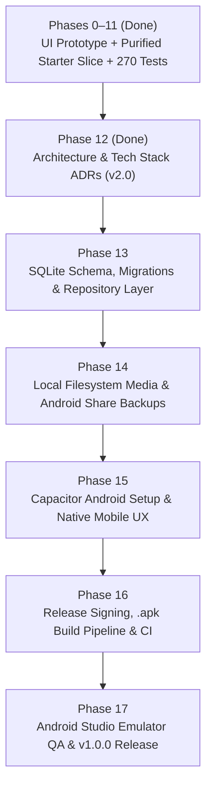

# Udeni's Specials — Implementation Roadmap

**Status:** All Phases (0–17) Complete — `v1.0.0` Released on `main`  
**Stack:** React 19 + Vite 8 + TypeScript 5.7 + Tailwind CSS v4 + Motion + Vitest → Capacitor Android `.apk` + On-Device SQLite (`@capacitor-community/sqlite`)  
**Target:** 100% local-first, offline-capable signed Android Mobile Application (`.apk`) with on-device SQLite, local filesystem photos, 1-tap Share Sheet backups (Google Drive/WhatsApp), and zero hosting cost

---

## Phase Dependency Overview

---

## Part 1 — Frontend Prototype & UI Refinements (Completed)

### Phase 0 — Planning approval (Completed)

Deliverables:
- [x] Architecture & requirements design (`docs/ARCHITECTURE_DECISIONS.md`).
- [x] Domain business rules and financial terminology agreed.
- [x] Minimalistic 4-tab mobile UX direction established.

### Phase 1 — Project foundation & tooling (Completed)

Completed:
- [x] Vite 8 + React 19 + TypeScript 5.7 + Tailwind CSS v4 scaffold (`package.json`, `vite.config.ts`).
- [x] Git repository, feature branching (`feature/remaining-workflows`), and remote tracking.
- [x] Type checking (`npx tsc --noEmit`), Vitest suite (`pnpm test --run`), and production build (`pnpm build`).

### Phase 2 — Design system and 4-tab navigation (Completed)

Completed:
- [x] Shared warm bakery design tokens (`src/index.css`) and reusable UI primitives (`Button`, `Card`, `Dialog`, `Field`, `SelectField`, `Sheet`, `GroupedList`, `StatusBadge`, `SegmentedControl`, `CountdownBadge`, `Toast`).
- [x] 4-tab bottom navigation (`Home`, `Orders`, `Kitchen`, `Money`) with stack transitions (`useNavigationStack.ts`) and sub-screens (`CustomersScreen`, `SettingsScreen`).
- [x] Narrow mobile viewport layout, empty states, and confirmation dialogs.

### Phase 3 — Domain models and financial rules (Completed)

Completed:
- [x] Typed domain models (`src/types.ts`) for products, variants, recipes, orders, order lines, preparation records, payments, refunds, expenses, shared allocations, and budgets.
- [x] Pure domain calculators and validators (`src/lib/pricing.ts`, `src/lib/financials.ts`, `src/lib/expenses.ts`, `src/lib/budget.ts`, `src/lib/countdown.ts`).
- [x] Automated unit tests covering margin/markup pricing, payment balances, refunds, expenses, and `dd:hh:mm:ss` countdowns.

### Phase 4 — Orders, products, recipes, and baking workflow (Completed)

Completed:
- [x] Multi-line order creation and editing (`CreateOrderFlow.tsx`) with saved recipes or `+ Customise` one-off recipes.
- [x] Product & variant catalogue (`ProductEditorSheet.tsx`) with optional **"Copy recipe from existing"** starter cloning, plus Recipe Library (`RecipeEditorSheet.tsx`, `RecipesScreen.tsx`) with inline `Rs./kg | L | unit` pricing, batch scaling, and version history.
- [x] Direct order-linked baking workflow (`PreparationProductScreen`): pantry checklist gate (`Have` / `Buy`) → `Start bake` transitions into minimalistic **Baking State** (scaled recipe + steps + `Cook mode` + live `dd:hh:mm:ss` recipe timer) → `Mark ready` (step-gated) redirects to the order's `Ready for pickup` page.
- [x] Live `dd:hh:mm:ss` pickup countdowns on `OrderCard` and `OrderDetailScreen`, plus `REPEAT_ORDER` drafts.

### Phase 5 — Shopping, purchases, and expenses (Completed)

Completed:
- [x] Manual pantry checklist-driven **Shopping** (`To buy`) list (`ShoppingScreen.tsx`) consolidating minimal total quantities across orders with calculated per-item and total `Rs.` estimates.
- [x] Purchase recording (`ShoppingTripSheet.tsx`, `PurchaseForm.tsx`) updating inventory quantities and unit costs.
- [x] Direct and shared expense recording and allocation (`MoneyScreen.tsx` → `Expenses`, `FinancesScreen.tsx`).

### Phase 6 — Pricing, payments, and due-balance tracking (Completed)

Completed:
- [x] Integrated `PricingCalculatorSheet` supporting margin/markup modes and manual agreed prices.
- [x] Step-by-step partial payments, refunds, and `Collected` auto-prompt to record remaining balance when due.
- [x] Standardized payment method dropdown (`Cash`, `Online transaction`, `Other` with optional specification).
- [x] Unpaid & part-paid visibility across the app: `Orders → Due` filter + `Due Rs. X` card cues, `Home` contextual **Payments due** banner, and tappable **Unpaid customer orders** sheet in `Money`.

### Phase 7 — Local persistence and migrations (Completed for Web Prototype)

Completed:
- [x] Versioned `localStorage` persistence (`src/state/persistence.ts`) with schema migration support and `PersistenceRecoveryScreen.tsx`.
- [x] Centralized validated reducer (`src/state/AppState.tsx`) with `dispatchIfAccepted` safety guards.
- [x] Persistence and reducer lifecycle test suites (`AppState.test.ts`, `ExtraStockLifecycle.test.ts`, `persistence.test.ts`).

### Phase 8 — Dashboard, reporting, and budgeting (Completed)

Completed:
- [x] `HomeScreen` driven by live selectors (`todaySelectors.ts`): `Up next`, workload counts, `Upcoming pickups`, `Due` payment alerts, and `Notifications`.
- [x] Minimalistic `MoneyScreen` with period filters, `Sales earned`, `Cash received`, `Money spent`, `Monthly goal`, category spend limits (`Budget`), and CSV exports (`orders`, `expenses`, `purchases`).

### Phase 9 — Backup, restore, and data recovery (Completed)

Completed:
- [x] Versioned JSON export and validated import (`BackupRestorePanel.tsx` in `SettingsScreen.tsx`).
- [x] Weekly backup reminders with dismiss/snooze controls.
- [x] Safe rejection of invalid backup files without corrupting live state.

### Phase 10 — UI Polish, Motion Physics & PWA Shell (Completed)

Completed:
- [x] Expanded multi-category food image library (`src/lib/imageLibrary.ts`) for cakes, pastries, pizzas, savories, and chili pastes, plus gallery photo upload & compression (`src/lib/imageUpload.ts`).
- [x] Swipe-to-clear notifications with Undo (`SwipeableRow.tsx`, `notificationState.ts`) and custom SVG illustrations (`Illustration.tsx`).
- [x] Physics-based spring motion system (`src/lib/motion.ts`), OKLCH color transitions, touch ripples (`TouchRipple.tsx`), hierarchical stagger choreography, and clipped zero-pop `PushView` page transitions.
- [x] Top-level `ErrorBoundary.tsx`, LAN-safe `createId()` (`src/lib/id.ts`), and PWA manifest/meta tags (`index.html`, `public/manifest.webmanifest`).

### Phase 11 — UI Purification & Minimal Starter Dataset (Completed)

Completed:
- [x] Split `src/data/demoData.ts` into `src/data/defaults.ts` (empty defaults), `src/data/starterData.ts` (1 customer, 1 product + 1 variant, 1 recipe with 6 inventory items, 1 order + `VITE_STARTER_MODE=minimal|empty`), and `src/test/demoFixture.ts`.
- [x] Fixed `migrateState()` so mock inventory is never injected into empty/restored workspaces, and added **Clear workspace (start empty)** / **Load minimal starter sample** in `SettingsScreen.tsx`.
- [x] Hardened empty states (`CreateOrderFlow.tsx`, `InventoryScreen.tsx`, `PersistenceRecoveryScreen.tsx`) and verified all 270 tests + production build.

---

## Part 2 — Local-First SQLite, Native Integration & Signed Android `.apk`

> [!NOTE]
> Each phase below is executed **one at a time**, ending with a verified test/build gate and Git commit before starting the next phase. This roadmap is a living document and will be updated whenever practical findings emerge.

### Phase 12 — Architecture & Tech Stack Decision Gate (`ARCHITECTURE_DECISIONS.md` v2.0) (Completed)

Completed:
- [x] Upgraded `docs/ARCHITECTURE_DECISIONS.md` to **v2.0** locking the **Local-First Capacitor Android `.apk` + On-Device SQLite** architecture (zero cloud server/hosting cost, 100% offline usability, 100% UI reuse).
- [x] Documented formal **ADR-001 through ADR-007** covering Capacitor packaging, local-first operation, SQLite migrations, multi-category food media, Share Sheet off-device backups, Whole LKR money precision, and consistently signed in-place `.apk` updates.

### Phase 13 — SQLite Database Schema, Migrations & Repository Layer (Completed)

**Goal:** Design the relational SQLite schema, versioned migrations, and transactional Repository / Unit-of-Work layer so business data moves from `localStorage` to rock-solid on-device SQLite. *(Tested fast in Chrome + Vitest; Android Studio not required yet.)*

Tasks:
- [x] Author `docs/DATABASE_SCHEMA.md` with Mermaid ERD, SQLite tables, foreign keys, `CHECK` constraints (non-negative stock, positive quantities, valid status enums), and indexes covering:
  - Settings, budget plan, notification preferences
  - Products, variants, recipes, immutable recipe versions, ingredients, packaging
  - Inventory items, append-only inventory movements, purchases, shopping trips & selections
  - Customers, orders, order lines (immutable recipe & cost snapshots), stock reservations, preparation records, extra-stock plans/batches/transactions
  - Append-only payments & refunds, expense categories, expenses, versioned expense allocations
- [x] Create versioned SQL migration runner (`0001_initial_schema`) in `src/db/migrator.ts` with idempotency-key support.
- [x] Build the `AppRepository` / `SqliteAppRepository` / `IndexedDbAppRepository` layers (`src/db/*`) and wire `AppStateProvider` with automatic one-time `localStorage` → repository import (`bootstrapAppRepository`).
- [x] **Exit gate:** Migration, constraint, transaction-rollback, round-trip, legacy-import, and idempotency tests pass in Vitest; `npx tsc --noEmit` and `pnpm build` succeed.

### Phase 14 — Native Local Media Storage & Android Off-Device Backups (Completed)

**Goal:** Store uploaded photos locally via a clean `MediaStore` abstraction, unlock customer order reference photos, and enable password-protected + 1-tap Share Sheet backups.

Tasks:
- [x] Implement `MediaStore` (`IndexedDbMediaStore` + `MemoryMediaStore`) in `src/lib/mediaStore.ts` with backup photo hydration (`resolveAppDataMediaForExport`) so Phase 15 Capacitor `@capacitor/filesystem` swaps in cleanly.
- [x] Unlock **Customer Order Reference Photo** attachment across `CreateOrderFlow.tsx`, `OrderDetailScreen.tsx`, `ImagePickerSheet.tsx`, `AppState.tsx`, and SQLite migration `0002_order_reference_photo`.
- [x] Upgrade `BackupRestorePanel.tsx` with 1-tap Share Sheet export (`src/lib/backupShare.ts` → Google Drive / WhatsApp / Download fallback) and optional password-protected AES-256-GCM encrypted backups (`src/lib/backupCrypto.ts`).
- [x] **Exit gate:** MediaStore, backup encryption/decryption, v2 migration upgrade, and full order photo workflow pass automated tests (`npx tsc --noEmit`, `pnpm test`, `pnpm build`).

### Phase 15 — Capacitor Android Setup & Native Mobile UX (Completed)

**Goal:** Wrap the React/Vite app in Capacitor Android and wire native hardware behavior so the app feels completely native on Android.

Tasks:
- [x] Initialize `@capacitor/core`, `@capacitor/cli`, `@capacitor/android`, `@capacitor-community/sqlite`, and native plugins pointing at `dist/`.
- [x] Configure Android app identity (`lk.udenisspecials.bakery`, app name *"Udeni's Specials"*), splash/icon resources, and `usesCleartextTraffic="false"`.
- [x] Implement `CapacitorSqliteEngine`, `CapacitorFilesystemMediaStore`, and native Share Sheet backup export (`src/db/engines/capacitorSqliteEngine.ts`, `src/lib/mediaStore.ts`, `src/lib/backupShare.ts`).
- [x] Wire Android **hardware/gesture Back button** (`src/lib/backStack.ts`, `src/lib/nativeBridge.ts`) into `Dialog`, `Sheet`, `ScreenHeader`, and root tab/exit flow, plus `StatusBar` & `Haptics`.
- [x] Add lightweight **Check for Updates** card in `SettingsScreen.tsx` (`src/lib/appVersion.ts` reading `VITE_UPDATE_FEED_URL`).
- [x] Verify live boot, SQLite persistence, Airplane Mode workflows, Camera/Gallery photos, encrypted Share backups, and Hardware Back button inside **Android Studio Emulator**.

### Phase 16 — Release Signing, `.apk` Build Pipeline & CI (Completed)

**Goal:** Establish repeatable, consistently signed `.apk` builds so future bug fixes and updates upgrade Udeni's phone in place without losing data.

Tasks:
- [x] Configure single-source `versionCode` / `versionName` management (`src/version.json`, `scripts/release-tools.mjs`, `src/lib/appVersion.ts`) and Gradle release `.apk` signing (`android/app/build.gradle`, `android/keystore.properties.example`, `scripts/build-apk.mjs`) with fail-fast guard against unsigned releases.
- [x] Set up GitHub Actions CI (`.github/workflows/ci.yml`) running `web-verify` (`typecheck`, `vitest`, `vite build`) and `android-debug-check` (`cap sync` + `./gradlew assembleDebug`) on every push/PR.
- [x] Document the step-by-step keystore setup, signed `.apk` build, and in-place update checklist (`docs/ANDROID_RELEASE_GUIDE.md`).
- [x] **Exit gate:** Version sync, Gradle signing guard, debug `.apk` build, and CI pipeline verified; ready for user's private `.jks` generation and Phase 17 QA.

### Phase 17 — Android Studio Emulator QA & `v1.0.0` Release (Completed)

**Goal:** Thoroughly test every offline, backup, and upgrade scenario on the Android Studio Emulator (plus final handoff to Udeni's phone) before daily use.

Tasks:
- [x] **Android Studio Emulator QA (`docs/QA_CHECKLIST_V1.md`):**
  1. Complete order → shopping → bake → payment flow in **Airplane Mode**.
  2. Force-close and reopen the app — verify 100% SQLite data & photo persistence.
  3. Export backup via Share Sheet / Files, wipe app data, restore backup — verify 100% integrity.
  4. **In-place `.apk` upgrade drill:** Install `v1.0.0 (Build 1)` `.apk`, create test orders/recipes, install `v1.0.1 (Build 2)` `.apk` (`versionCode + 1`, same keystore) over it (`adb install -r`) — verified zero data loss and clean upgrade.
  5. Verify hardware Back button, camera/gallery picker, soft keyboard over forms, and 60fps `PushView` transitions.
- [x] Build final gold signed `v1.0.0` `.apk` (`udenis-specials-v1.0.0-b1-release.apk`, `starter=empty`).
- [x] Merge verified milestone cleanly to `main` and tag `v1.0.0`.
- [x] **Exit gate:** Signed `v1.0.0` `.apk` verified offline on Android with tested Share backups and verified in-place upgrade path.

### Phase 18 — Full-Codebase Audit Remediation & `v1.1.0` Hardening (In Progress)

**Goal:** Resolve all 22 architectural, accounting, native Android, UI state, and accessibility findings identified in the post-v1.0 codebase audit across 5 verified milestones (`feat/v1-1-0-audit-remediation`).

Tasks:
- [x] **Workstream 1 — Schema, Referential Integrity & Backup Safety:** Enforce strict backup payload validation, shared-allocation adjustment on cancellation, safe variant unlinking/finished-inventory validation, and unit-converted scoping on preparation line completion.
- [x] **Workstream 2 — Financial Math, Timezone Determinism & Reducer Purity:** Enforce `Asia/Colombo` calendar dates & countdown targets across OS timezones, IEEE 754 currency rounding stability, `Cancelled` order zero-COGS profit rule, atomic `RECORD_REFUNDS`, `FINISH_PREPARATION_SIMPLE` clamped physical stock deduction + movements, and non-poisoning idempotency keys.
- [x] **Workstream 3 — Native Android & Shell UX:** Route CSV and recovery raw exports through the native Android Share Sheet, relax Android backup picker MIME filtering with retry safety, isolate `ScreenHeader` hardware back handlers during transitions (`useIsPresent()`), bind `KitchenModeOverlay` back/Escape/scroll-lock, hide bottom navigation while soft keyboard is open, and elevate toasts above modals (`z-[60]`).
- [x] **Workstream 4 — Screen Bugs, State Sync & Motion:** Fix `AnimatedItem` reduced-motion visibility, prevent `RecipeEditorSheet` background state resets, stabilize `KitchenModeOverlay` timer & dark-mode contrast, wire Home `Up next` preparation deep links accurately, clean up nested dialog scroll traps & missing low-stock color tokens, and keep reminders dismissible without swipe gestures.
- [ ] **Workstream 5 — Accessibility, Polish, `v1.1.0 (Build 3)` Release & Emulator QA:** Clean up disabled button opacity/nudge states, `useId()` uniqueness across form inputs/dialogs, keyboard focus rings on custom checkboxes, CI branch triggers, and verify signed `v1.1.0` in-place upgrade on the Android Emulator before merging to `main`.

---

## Development rules

- Work on one milestone at a time and keep this roadmap updated as decisions evolve.
- Use small, conventional Git commits at verified checkpoints and push to `origin`.
- Require human review of architecture decisions, schema changes, and AI-generated changes.
- Run typecheck, automated tests, and build verification before marking a phase complete.
- Never lose or rotate the release signing keystore (required for in-place `.apk` updates).
- Maintain a clear record of incomplete work and known limitations.

## Definition of project completion

The release is complete when Udeni can manage real orders, recipes, inventory, shopping, preparation, expenses, payments, and photos reliably offline in an **installed, signed Android `.apk`** backed by on-device SQLite, 1-tap Google Drive/Share backups, and a verified in-place `.apk` update workflow.
