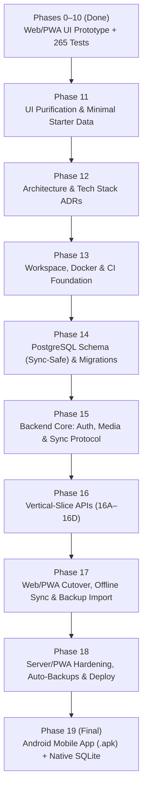

# Udeni's Specials — Implementation Roadmap

**Status:** Part 1 (Web/PWA UI Prototype) Complete — Entering Part 2 (Backend & Full-Stack Evolution) on `feature/remaining-workflows`  
**Stack:** React 19 + Vite 8 + TypeScript 5.7 + Tailwind CSS v4 + Motion + Vitest (Backend & Android APK stack to be locked in Phase 12 ADRs)  
**Target:** Offline-capable Web & Installable PWA with Dockerized Backend (Phases 11–18), followed by signed Android Mobile Application `.apk` (Phase 19)

---

## Phase Dependency Overview

---

## Part 1 — Frontend Prototype & UI Refinements (Completed)

### Phase 0 — Planning approval (Completed)

Deliverables:
- [x] Architecture & requirements design (`docs/ARCHITECTURE_DECISIONS.md`).
- [x] Domain business rules and financial terminology agreed.
- [x] Minimalistic 4-tab mobile UX direction established.

### Phase 1 — Project foundation & tooling (Completed)

Completed:
- [x] Vite 8 + React 19 + TypeScript 5.7 + Tailwind CSS v4 scaffold (`package.json`, `vite.config.ts`).
- [x] Git repository, feature branching (`feature/remaining-workflows`), and remote tracking.
- [x] Type checking (`npx tsc --noEmit`), Vitest suite (`pnpm test --run`), and production build (`pnpm build`).

### Phase 2 — Design system and 4-tab navigation (Completed)

Completed:
- [x] Shared warm bakery design tokens (`src/index.css`) and reusable UI primitives (`Button`, `Card`, `Dialog`, `Field`, `SelectField`, `Sheet`, `GroupedList`, `StatusBadge`, `SegmentedControl`, `CountdownBadge`, `Toast`).
- [x] 4-tab bottom navigation (`Home`, `Orders`, `Kitchen`, `Money`) with stack transitions (`useNavigationStack.ts`) and sub-screens (`CustomersScreen`, `SettingsScreen`).
- [x] Narrow mobile viewport layout, empty states, and confirmation dialogs.

### Phase 3 — Domain models and financial rules (Completed)

Completed:
- [x] Typed domain models (`src/types.ts`) for products, variants, recipes, orders, order lines, preparation records, payments, refunds, expenses, shared allocations, and budgets.
- [x] Pure domain calculators and validators (`src/lib/pricing.ts`, `src/lib/financials.ts`, `src/lib/expenses.ts`, `src/lib/budget.ts`, `src/lib/countdown.ts`).
- [x] Automated unit tests covering margin/markup pricing, payment balances, refunds, expenses, and `dd:hh:mm:ss` countdowns.

### Phase 4 — Orders, products, recipes, and baking workflow (Completed)

Completed:
- [x] Multi-line order creation and editing (`CreateOrderFlow.tsx`) with saved recipes or `+ Customise` one-off recipes.
- [x] Product & variant catalogue (`ProductEditorSheet.tsx`) with optional **"Copy recipe from existing"** starter cloning, plus Recipe Library (`RecipeEditorSheet.tsx`, `RecipesScreen.tsx`) with inline `Rs./kg | L | unit` pricing, batch scaling, and version history.
- [x] Direct order-linked baking workflow (`PreparationProductScreen`): pantry checklist gate (`Have` / `Buy`) → `Start bake` transitions into minimalistic **Baking State** (scaled recipe + steps + `Cook mode` + live `dd:hh:mm:ss` recipe timer) → `Mark ready` (step-gated) redirects to the order's `Ready for pickup` page.
- [x] Live `dd:hh:mm:ss` pickup countdowns on `OrderCard` and `OrderDetailScreen`, plus `REPEAT_ORDER` drafts.

### Phase 5 — Shopping, purchases, and expenses (Completed)

Completed:
- [x] Manual pantry checklist-driven **Shopping** (`To buy`) list (`ShoppingScreen.tsx`) consolidating minimal total quantities across orders with calculated per-item and total `Rs.` estimates.
- [x] Purchase recording (`ShoppingTripSheet.tsx`, `PurchaseForm.tsx`) updating inventory quantities and unit costs.
- [x] Direct and shared expense recording and allocation (`MoneyScreen.tsx` → `Expenses`, `FinancesScreen.tsx`).

### Phase 6 — Pricing, payments, and due-balance tracking (Completed)

Completed:
- [x] Integrated `PricingCalculatorSheet` supporting margin/markup modes and manual agreed prices.
- [x] Step-by-step partial payments, refunds, and `Collected` auto-prompt to record remaining balance when due.
- [x] Standardized payment method dropdown (`Cash`, `Online transaction`, `Other` with optional specification).
- [x] Unpaid & part-paid visibility across the app: `Orders → Due` filter + `Due Rs. X` card cues, `Home` contextual **Payments due** banner, and tappable **Unpaid customer orders** sheet in `Money`.

### Phase 7 — Local persistence and migrations (Completed for Web Prototype)

Completed:
- [x] Versioned `localStorage` persistence (`src/state/persistence.ts`) with schema migration support and `PersistenceRecoveryScreen.tsx`.
- [x] Centralized validated reducer (`src/state/AppState.tsx`) with `dispatchIfAccepted` safety guards.
- [x] Persistence and reducer lifecycle test suites (`AppState.test.ts`, `ExtraStockLifecycle.test.ts`, `persistence.test.ts`).

### Phase 8 — Dashboard, reporting, and budgeting (Completed)

Completed:
- [x] `HomeScreen` driven by live selectors (`todaySelectors.ts`): `Up next`, workload counts, `Upcoming pickups`, `Due` payment alerts, and `Notifications`.
- [x] Minimalistic `MoneyScreen` with period filters, `Sales earned`, `Cash received`, `Money spent`, `Monthly goal`, category spend limits (`Budget`), and CSV exports (`orders`, `expenses`, `purchases`).

### Phase 9 — Backup, restore, and data recovery (Completed)

Completed:
- [x] Versioned JSON export and validated import (`BackupRestorePanel.tsx` in `SettingsScreen.tsx`).
- [x] Weekly backup reminders with dismiss/snooze controls.
- [x] Safe rejection of invalid backup files without corrupting live state.

### Phase 10 — UI Polish, Motion Physics & PWA Shell (Completed)

Completed:
- [x] Expanded multi-category food image library (`src/lib/imageLibrary.ts`) for cakes, pastries, pizzas, savories, and chili pastes, plus gallery photo upload & compression (`src/lib/imageUpload.ts`).
- [x] Swipe-to-clear notifications with Undo (`SwipeableRow.tsx`, `notificationState.ts`) and custom SVG illustrations (`Illustration.tsx`).
- [x] Physics-based spring motion system (`src/lib/motion.ts`), OKLCH color transitions, touch ripples (`TouchRipple.tsx`), hierarchical stagger choreography, and clipped zero-pop `PushView` page transitions.
- [x] Top-level `ErrorBoundary.tsx`, LAN-safe `createId()` (`src/lib/id.ts`), and PWA manifest/meta tags (`index.html`, `public/manifest.webmanifest`).

---

## Part 2 — Backend, Containerization & Offline-Capable Web/PWA (Next)

> [!NOTE]
> Each phase below is executed **one at a time**, ending with a verified test/build gate and Git commit before starting the next phase. This roadmap is a living document and will be updated whenever architectural or scope decisions evolve.

### Phase 11 — UI Purification & Minimal Starter Dataset

**Goal:** Remove bloated mock/demo data from the runtime app while keeping a minimal, realistic 1-item slice to verify every UI workflow, without breaking any automated tests.

Tasks:
- [ ] Split `src/data/demoData.ts` into:
  - `src/data/defaults.ts` — pure empty production defaults (`defaultSettings`, `defaultBudgetPlan`, built-in expense categories, empty collections).
  - `src/data/starterData.ts` — minimal UI verification seed: **1 customer, 1 product (+ 1 variant), 1 recipe (with its required ingredients & packaging), and 1 active order** (zero historical mock orders, fake expenses, or extra-stock clutter).
  - `src/test/demoFixture.ts` — full multi-record test fixture moved under `src/test/` for unit tests (`persistence.test.ts`, `AppState.test.ts`).
- [ ] Update `SettingsScreen.tsx` copy (*"Reset demo data"* → *"Load starter sample"* / *"Clear workspace"*) and add a `VITE_STARTER_MODE=minimal|empty` flag for testing blank vs. 1-item boot.
- [ ] Verify every screen's empty state (`Home`, `Orders`, `Shopping`, `Recipes`, `Inventory`, `Money`, `Customers`, `Notifications`) renders cleanly on empty and minimal data.
- [ ] **Exit gate:** All 265+ unit tests pass, `pnpm build` succeeds, and manual UI walkthrough confirms every workflow operates cleanly on empty and minimal 1-item states.

### Phase 12 — Architecture & Tech Stack Decision Gate (`ARCHITECTURE_DECISIONS.md` v2.0)

**Goal:** Reconcile `docs/ARCHITECTURE_DECISIONS.md` with all UI refinements and formally lock the Web/PWA + Dockerized Backend + APK-ready architecture before writing backend code.

Tasks:
- [ ] Update `docs/ARCHITECTURE_DECISIONS.md` to **v2.0** with formal Architecture Decision Records (ADRs):
  - **ADR-001 (Delivery Sequence):** Mobile-first Web + Installable PWA with Dockerized Backend first (Phases 13–18), followed by signed Android `.apk` packaging via Capacitor in Phase 19.
  - **ADR-002 (Expanded Food Domain & Media):** Multi-category home food & bakery catalogue + preset artwork & cloud-stored photos.
  - **ADR-003 (Backend Stack & Shared Domain):** Backend runtime/framework (recommended: Node.js + TypeScript + Fastify/Hono) and shared `packages/domain` package for `pricing`, `financials`, `inventory`, `expenses`, `orderLifecycle`, and Zod schemas.
  - **ADR-004 (Database & Sync-Safe Design):** PostgreSQL 17 + ORM/migration tool (Drizzle or Prisma), ACID transactions, `JSONB` immutable snapshots, and sync-safe metadata (`id` client-generated, `revision`, `updated_at`, `deleted_at`, `idempotency_keys`, append-only ledgers) so PWA offline sync and future Android SQLite require zero schema redesign.
  - **ADR-005 (Object Storage):** S3-compatible storage (MinIO in Docker locally; Cloudflare R2 / AWS S3 in production) for item photos, customer order reference photos, and receipts.
  - **ADR-006 (Auth & Security):** Owner authentication, session/refresh tokens, password hashing (`argon2`/`scrypt`), CORS (Web, PWA, and future Capacitor origin), and rate limiting.
  - **ADR-007 (Dual-Layer Backups):** Automated daily server PostgreSQL backups (`pg_dump`) + user-triggered v2 JSON backup export/restore.
  - **ADR-008 (Monetary Precision):** Reconcile §15.6 minor units vs. whole-LKR integer totals + high-precision `average_unit_cost` (`NUMERIC(12,4)`).
- [ ] **Exit gate:** All ADRs reviewed and signed off in `docs/ARCHITECTURE_DECISIONS.md`.

### Phase 13 — Workspace Restructure, Dockerization & CI Foundation

**Goal:** Establish a reproducible pnpm monorepo and containerized development/production environment.

Tasks:
- [ ] Convert repository to a **pnpm workspace** preserving full Git history:
  - `apps/web` — React + Vite Web/PWA frontend
  - `apps/api` — Backend API server (initial `/health` and `/ready` endpoints)
  - `packages/domain` — shared TypeScript types, Zod schemas, and pure calculators
- [ ] Containerize services with multi-stage Dockerfiles and Compose:
  - `apps/web/Dockerfile` (dev HMR target + prod Nginx static target)
  - `apps/api/Dockerfile` (dev watch target + lean non-root prod Node target)
  - `docker-compose.yml` + `docker-compose.dev.yml` orchestrating `web`, `api`, `postgres` (named volume + healthcheck), and `minio` (S3-compatible object storage + bucket init).
- [ ] Add `.env.example`, `.dockerignore`, root convenience scripts, and GitHub Actions CI (`.github/workflows/ci.yml`) running typecheck, unit tests, and Docker build validation.
- [ ] **Exit gate:** `docker compose up` starts all containers cleanly; `/health` and `/ready` return `200 OK`; all existing tests pass inside the workspace.

### Phase 14 — Database Schema Design, Constraints & Migrations

**Goal:** Design, review, and validate the normalized PostgreSQL schema with strict integrity constraints, indexes, sync-safe columns, and versioned SQL migrations.

Tasks:
- [ ] Author `docs/DATABASE_SCHEMA.md` with Mermaid ERD, table definitions, transaction boundaries, and indexing plan covering:
  1. **Accounts & Preferences:** `users`, `sessions`, `business_settings`, `budget_plans`, `notification_preferences`
  2. **Catalogue & Recipes:** `products`, `product_variants`, `recipes`, `recipe_versions`, `recipe_ingredients`, `recipe_packaging`, `media_assets`
  3. **Inventory & Procurement:** `inventory_items`, `inventory_movements` (append-only), `purchases`, `shopping_trips`, `shopping_trip_items`, `shopping_selections`
  4. **Orders & Production:** `customers`, `orders`, `order_lines` (immutable `recipe_snapshot` + `cost_snapshot` `JSONB`), `stock_reservations`, `preparation_records`, `extra_stock_plans`, `extra_stock_preparations`, `finished_stock_batches`, `finished_stock_transactions`
  5. **Finances:** `payments` (append-only), `refunds` (append-only), `expense_categories`, `expenses`, `expense_allocation_versions`, `expense_allocations`
  6. **Sync & Idempotency:** `idempotency_keys` + universal sync-ready columns (`id`, `revision`, `updated_at`, `deleted_at`)
- [ ] Enforce DB-level constraints (`CHECK` non-negative stock, positive quantities, valid enums, foreign keys, archive-over-delete) and composite indexes.
- [ ] Author initial migration (`0001_initial_schema`) + idempotent minimal starter seed script matching Phase 11.
- [ ] Add automated migration and constraint tests against real Docker PostgreSQL.
- [ ] **Exit gate:** Migrations apply/rollback cleanly on fresh Postgres; constraint tests reject negative stock, duplicate deductions, and orphan refunds.

### Phase 15 — Backend Core Foundation (Auth, Middleware, Media & Sync Contract)

**Goal:** Build the reusable backend server core, authentication, object storage uploads, idempotency, and sync endpoints.

Tasks:
- [ ] Layered API architecture (`routes → Zod validators → application services → transactional repositories → Postgres`), centralized error envelope, structured logging, CORS, security headers, rate limiting, and OpenAPI docs (`/docs`).
- [ ] Owner authentication endpoints (`POST /api/v1/auth/setup`, `/login`, `/refresh`, `/logout`, `GET /me`).
- [ ] Media upload pipeline (`POST /api/v1/media/upload` / presigned URLs → MinIO/S3, MIME/size validation, thumbnail optimization, orphaned file cleanup).
- [ ] Idempotency middleware (`Idempotency-Key` header backed by `idempotency_keys`) + sync delta contract (`POST /api/v1/sync/push`, `GET /api/v1/sync/pull`) ready for offline PWA & future Android APK sync.
- [ ] Integration test harness running against real Docker Postgres & MinIO.
- [ ] **Exit gate:** Auth flows, media upload round-trip, idempotency replay protection, and OpenAPI docs pass automated integration tests.

### Phase 16 — Backend Domain APIs (Vertical-Slice Delivery)

**Goal:** Deliver all server-side domain APIs incrementally in 4 focused, independently testable slices:

- [ ] **16A — Catalogue, Recipes & Inventory Master Slice:** Products, variants, recipes + immutable version history, inventory items, manual stock adjustments (atomic movement + balance), settings, and budget plan.
- [ ] **16B — Customers, Orders & Reservations Slice (Transactional Core):** Customers, draft/confirm/edit/cancel/collect/repeat orders, atomic reservation & shortage creation, immutable cost/recipe snapshots, and cancellation settlements.
- [ ] **16C — Shopping, Purchases, Preparation & Extra-Stock Slice:** Consolidated shopping requirements, shopping trips/invoices, purchases & corrections with atomic moving weighted-average valuation, idempotent order & extra-stock preparation completion, finished-stock batches, quick sales, and write-offs.
- [ ] **16D — Finances, Reporting, Backup/Restore & Notifications Slice:** Partial payments, validated refunds, direct & shared expenses with versioned allocations, financial summaries & CSV exports, server-side JSON backup export & transactional restore (compatible with prototype v2 JSON backups), and synced notification preferences.
- [ ] **Exit gate (per slice):** Integration tests against real Postgres verify every domain invariant, rollback on failure, and double-submit idempotency.

### Phase 17 — Web & PWA Frontend Cutover, Offline Support & Backup Migration

**Goal:** Connect the React Web/PWA frontend to the live backend behind a clean repository abstraction with genuine PWA offline usability.

Tasks:
- [ ] Introduce a typed API client + **TanStack Query** + **Storage/Repository interface** (`IndexedDB` local cache & outbox queue for Web/PWA — designed so native Android SQLite swaps in cleanly in Phase 19).
- [ ] Add **PWA offline capability** (`vite-plugin-pwa` / Workbox service worker) for offline boot, Home Screen installation, and automatic background outbox sync with a subtle **Sync Status indicator** (`Synced` · `Pending` · `Offline` · `Retry`).
- [ ] Add Owner Login / First-time Setup screen, Account / Sign-out controls in `SettingsScreen`, loading skeletons, and pending-mutation guards.
- [ ] Upgrade `ImagePickerSheet` to upload photos to `/api/v1/media` (URLs instead of base64) and add the deferred **Customer Order Reference Photo** attachment on orders.
- [ ] Build **"Import Local Backup to Cloud"** in `SettingsScreen` so existing prototype `localStorage` data or v2 JSON backup files migrate smoothly into PostgreSQL.
- [ ] **Exit gate:** Full order → shopping → bake → payment workflow runs end-to-end across Web & installed mobile PWA, handles brief offline periods cleanly, and syncs across devices.

### Phase 18 — Production Web/PWA & Server Hardening, Automated Backups & Deployment

**Goal:** Deploy and harden the containerized Web/PWA + Backend stack for reliable daily business use.

Tasks:
- [ ] Production Docker Compose stack with HTTPS/TLS reverse proxy (Caddy or Nginx + Let's Encrypt), strict CORS, rate limiting, secret management, and non-root containers.
- [ ] Automated daily encrypted PostgreSQL backups (`pg_dump` to off-box object storage with 30-day retention) + tested restore drill, alongside manual on-demand JSON backup export in `SettingsScreen`.
- [ ] Observability: structured logs, `/health` & `/ready` probes, uptime alert, and error reporting hooked into `ErrorBoundary`.
- [ ] End-to-end QA on real mobile browsers (Android Chrome PWA install, camera upload, offline reload, backup restore).
- [ ] Merge verified Web/PWA + Backend milestone to `main` and tag `v1.0.0-web`.
- [ ] **Exit gate:** Udeni can run daily operations reliably on the deployed Web/PWA with cloud persistence, automatic daily backups, and manual JSON export/restore.

---

## Part 3 — Final Mobile Application Packaging

### Phase 19 (Final Phase) — Android Mobile Application (`.apk`)

**Goal:** Package the proven Web/PWA application into a native, airplane-mode-capable Android `.apk` without rewriting the UI or backend.

Tasks:
- [ ] Initialize **Capacitor Android** (`@capacitor/core`, `@capacitor/cli`, `@capacitor/android`) wrapping `apps/web/dist`.
- [ ] Swap the frontend's Storage/Repository adapter (from Phase 17) to native **`@capacitor-community/sqlite`** so the Android app runs full offline transactions on a persistent on-device SQLite database synced to the Dockerized PostgreSQL backend when online.
- [ ] Integrate native Android plugins:
  - `@capacitor/camera` + local photo upload queue (capture/pick photos offline, upload when online).
  - `@capacitor/filesystem` + `@capacitor/share` — **offline manual backup export & restore** directly to Android Files, WhatsApp, or Google Drive with zero internet.
  - `@capacitor/app` — Android **hardware/gesture Back button** wired into `PushView`, `Sheet`, and `Dialog` navigation.
  - `@capacitor/status-bar`, `@capacitor/keyboard`, `@capacitor/haptics`, `@capacitor/network` — native polish & reliable connectivity sensing.
- [ ] Configure Android identity (`applicationId`, app name *"Udeni's Specials"*, adaptive icon, splash screen, HTTPS-only `network_security_config.xml`) and release signing keystore (stored outside Git) to produce signed `.apk` builds.
- [ ] **Physical Android Device QA:** Airplane-mode end-to-end bake/order/payment flow, force-close recovery, online background sync without duplicates, offline backup export + wipe + restore, hardware Back button, and camera uploads.
- [ ] Tag `v1.0.0-android` and document APK build & update steps.
- [ ] **Exit gate:** Signed Android `.apk` runs reliably offline and online on Udeni's Android phone, synced seamlessly with the production backend.

---

## Development rules

- Work on one phase/milestone at a time and keep this roadmap updated as decisions evolve.
- Use small, conventional Git commits at verified checkpoints and push to `origin`.
- Require human review of architecture decisions, schema changes, and AI-generated changes.
- Run typecheck, automated tests, and relevant integration checks before marking a phase complete.
- Do not skip earlier exit gates to jump ahead to later features.
- Maintain a clear record of incomplete work and known limitations.

## Definition of project completion

The full-stack release is complete when Udeni can manage real orders, recipes, inventory, shopping, preparation, expenses, payments, and photos reliably on both **Web/PWA** and the **installed Android `.apk`** — working seamlessly offline or online, backed by containerized PostgreSQL, automated daily cloud backups, and tested manual JSON backup/restore.
